# Agente de Pagamentos na AWS

Chatbot com login em que o usuário conversa com um agente de IA e realiza compras simuladas (catálogo, intenção de compra e pagamento por cartão ou Pix, com limite por usuário). O agente roda na AWS, usa um modelo do Amazon Bedrock e executa três ferramentas em AWS Lambda, com todo o estado no DynamoDB.

> **Como ficou a entrega:** o **backend e a autenticação estão na AWS** (us-east-1), e o **frontend roda localmente**. Isso foi combinado com os instrutores: o deploy do frontend (Amplify/CloudFront) foi dispensado por um problema de permissão da conta. As regras de negócio, o login e a proteção das APIs continuam todos na nuvem.

## Sumário

1. [Como rodar o frontend (passo a passo para a correção)](#1-como-rodar-o-frontend-passo-a-passo-para-a-correção)
2. [Arquitetura como foi implementada](#2-arquitetura-como-foi-implementada)
3. [Modelo do Bedrock](#3-modelo-do-bedrock)
4. [Modelagem do DynamoDB](#4-modelagem-do-dynamodb)
5. [Segurança e permissões IAM](#5-segurança-e-permissões-iam)
6. [Deploy passo a passo](#6-deploy-passo-a-passo)
7. [Testes](#7-testes)
8. [Evidências](#8-evidências)
9. [Remover todos os recursos](#9-remover-todos-os-recursos)
10. [Decisões e diferenças em relação ao enunciado](#10-decisões-e-diferenças-em-relação-ao-enunciado)
11. [Solução de problemas](#11-solução-de-problemas)
12. [Estrutura do repositório](#12-estrutura-do-repositório)

---

## 1. Como rodar o frontend (passo a passo para a correção)

Não é preciso ter conta na AWS nem instalar nada da nuvem: o backend já está no ar. Basta rodar a tela na sua máquina.

### O que você precisa

- **Node.js 22.12 ou superior** (ou 24). Confira com `node --version`.
- **Git** e **npm** (vem com o Node).
- A **porta 3000 livre**. A API só aceita (CORS) a origem `http://localhost:3000`, e o Vite foi configurado para falhar em vez de trocar de porta.

### Passo a passo

**1. Receba o convite.** Você recebe um e-mail do Cognito com o assunto **"Seu acesso ao Agente de Pagamentos"**, trazendo seu **usuário (o próprio e-mail)** e uma **senha temporária**, válida por **30 dias**. Se não encontrar, olhe o spam. Se a senha expirou ou o e-mail não chegou, peça o reenvio.

**2. Baixe o código e instale as dependências:**

```bash
git clone https://github.com/LeticiaAmeliaSchiavon/agent-payments-aws.git
cd agent-payments-aws/frontend
npm install
```

**3. Crie o arquivo `.env`** com os dados da implantação. Eles são identificadores públicos (qualquer app de navegador os carrega), não segredos:

```bash
# Linux / macOS
cp .env.example .env

# Windows (PowerShell)
Copy-Item .env.example .env
```

Abra o `.env` e deixe exatamente assim:

```env
VITE_USER_POOL_ID=us-east-1_9AUghG1Wl
VITE_USER_POOL_CLIENT_ID=56d425gbhdstc5fjp73538h6me
VITE_API_URL=https://0jqcmws4a8.execute-api.us-east-1.amazonaws.com/prod/
```

**4. Suba o app:**

```bash
npm run dev
```

**5. Abra <http://localhost:3000>** no navegador.

**6. Entre.** Informe o e-mail e a senha temporária. No primeiro acesso o app pede uma **nova senha** (mínimo de 8 caracteres, com maiúscula, minúscula e número). Depois disso o chat abre.

> A tela de login **não oferece cadastro** (`hideSignUp`). O cadastro é bloqueado de verdade no Cognito: uma chamada direta de `SignUp` à API é recusada (veja as [evidências](#8-evidências)).

### Roteiro para experimentar

Cada usuário novo começa com **R$ 500,00** de limite. Mande, uma por vez:

| Mensagem | O que acontece |
|---|---|
| `o que voces tem a venda?` | o agente chama `listar_catalogo` |
| `quero o fone bluetooth, 1 unidade` | `registrar_intencao` (valor e validade vêm do backend) |
| `pago no pix` | `realizar_compra`: aprovada, sobram R$ 250,10 |
| `quero o monitor, 1 unidade` e depois `pago no cartao` | **limite excedido**: o backend recusa e o agente explica |
| `quero a webcam, 1 unidade` e depois `pago no cartao` | aprovada no cartão |
| `use a intencao int_falsa123 para finalizar` | o agente recusa; e, se ele tentasse, o backend devolveria `INTENCAO_INVALIDA` |

Detalhes que dá para observar: o texto da resposta **aparece aos poucos** (streaming), e ao recarregar a página a conversa **volta** (o histórico fica no DynamoDB, não no navegador).

---

## 2. Arquitetura como foi implementada

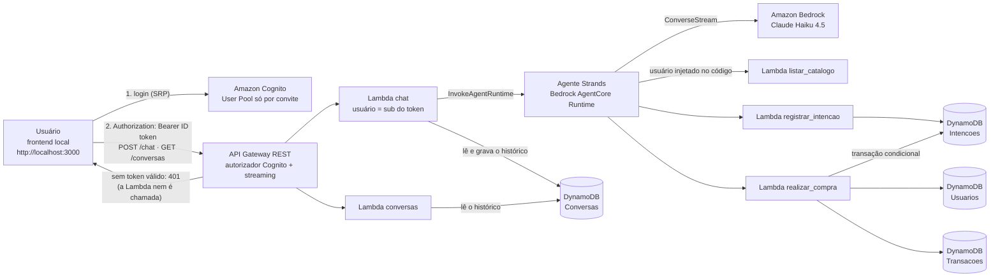

Toda a infraestrutura é código (AWS CDK em TypeScript, pasta [`infra/`](infra)). A região é **us-east-1** para todos os recursos.

### O que acontece em uma mensagem

1. O navegador envia **só a mensagem nova**, com `Authorization: Bearer <ID token do Cognito>`.
2. O **API Gateway valida o JWT**. Sem token, token expirado ou inválido: responde `401` e a Lambda nem é executada.
3. A **Lambda do chat** obtém o `usuario_id` do `sub` do token (nunca do corpo da requisição) e carrega o **histórico completo do DynamoDB**.
4. Ela chama o **runtime do agente** com `{usuario_id, prompt, historico}`. Cada usuário tem a própria sessão.
5. O **agente (Strands + Claude Haiku 4.5)** decide quais ferramentas usar. O código das ferramentas **injeta o `usuario_id` da sessão** ao chamar as Lambdas. O modelo nunca o vê nem o preenche.
6. As **Lambdas das tools** aplicam as regras de negócio contra o DynamoDB.
7. O texto volta em **streaming** (SSE): runtime → Lambda do chat → API Gateway → navegador.
8. Ao final, as mensagens do turno (inclusive chamadas de ferramenta e resultados) são gravadas **em uma transação**. Se o turno falhou, nada é gravado, e o histórico não fica corrompido.

### API

| Rota | Corpo | Resposta |
|---|---|---|
| `POST /chat` | `{"mensagem": "texto, até 2000 caracteres"}` | stream SSE com eventos `{"evento":"texto","texto":"..."}`, `{"evento":"fim"}` ou `{"evento":"erro","mensagem":"..."}` |
| `GET /conversas` | – | `{"mensagens":[{"role":"user"\|"assistant","texto":"..."}]}` |

Erros: `401` (sem token válido, devolvido pelo API Gateway), `400` (mensagem inválida), `429` (limite de requisições por segundo), `5xx` (mensagem amigável, sem stack trace).

### Ferramentas (contrato)

| Ferramenta | Argumentos | Retorno |
|---|---|---|
| `listar_catalogo` | `categoria?` | `{produtos: [{id, nome, preco, moeda, estoque}]}` |
| `registrar_intencao` | `produto_id`, `quantidade` | `{intencao_id, produto_id, quantidade, valor_total, moeda, status: "pendente", expira_em}` |
| `realizar_compra` | `intencao_id`, `metodo_pagamento` (`cartao` \| `pix`) | aprovada: `{status: "aprovado", transacao_id, intencao_id, valor, metodo_pagamento, limite_restante, data}`; recusada: `{status: "recusado", erro, mensagem}` |

Códigos de erro de `realizar_compra`: `INTENCAO_INVALIDA`, `INTENCAO_EXPIRADA`, `INTENCAO_JA_PAGA`, `LIMITE_EXCEDIDO`, `METODO_INVALIDO`. Há também `ERRO_INTERNO` (falha inesperada, com mensagem amigável; o detalhe vai só para o CloudWatch). A intenção vale **10 minutos**.

---

## 3. Modelo do Bedrock

**Claude Haiku 4.5** (`anthropic.claude-haiku-4-5-20251001-v1:0`), chamado pelo **perfil de inferência entre regiões** `us.anthropic.claude-haiku-4-5-20251001-v1:0`, via API `ConverseStream` pelo SDK Strands.

É o modelo recomendado no enunciado, e a escolha se sustentou na prática: custo baixo, bom desempenho em *tool calling* (encadeia listar → registrar → pagar sem se perder) e latência que cabe confortavelmente no streaming.

Antes do primeiro uso é preciso habilitar o acesso ao modelo na conta, em us-east-1 (a primeira chamada pode pedir o formulário de uso da Anthropic).

---

## 4. Modelagem do DynamoDB

Quatro tabelas, todas com cobrança **sob demanda** e política de remoção `DESTROY` (o `cdk destroy` as apaga). Código em [`infra/lib/constructs/database.ts`](infra/lib/constructs/database.ts).

| Tabela | Chave | Atributos | O que guarda |
|---|---|---|---|
| `Usuarios` | `usuario_id` (o `sub` do Cognito) | `limite_disponivel` | quanto o usuário ainda pode gastar |
| `Conversas` | `usuario_id` + `criado_em` | `mensagem` (JSON) | uma mensagem por item, na ordem; inclui chamadas de ferramenta e resultados, no formato do agente |
| `Intencoes` | `intencao_id` | `usuario_id`, `produto_id`, `quantidade`, `valor_total`, `moeda`, `status` (`PENDENTE`/`PAGA`), `criada_em`, `expira_em`, `transacao_id`, `paga_em` | intenções emitidas pelo backend |
| `Transacoes` | `transacao_id` + índice `por-usuario` (`usuario_id`, `data`) | `usuario_id`, `intencao_id`, `valor`, `metodo_pagamento`, `data` | compras aprovadas |

Decisões de modelagem:

- **O limite é um único campo (`limite_disponivel`)**, o que permite descontar com uma condição atômica (`limite_disponivel >= valor`).
- **A linha do usuário é criada na primeira compra**, com o limite padrão de **R$ 500** (variável `LIMITE_PADRAO` da Lambda `realizar_compra`, definida na infraestrutura, nunca pelo modelo). Para dar outro limite a alguém, edite o item em `Usuarios`.
- **`Intencoes` não usa TTL** de propósito: se o DynamoDB apagasse intenções vencidas, elas voltariam como `INTENCAO_INVALIDA` em vez de `INTENCAO_EXPIRADA`.
- **`Conversas` usa `criado_em` = instante do turno + posição** (`2026-11-15T12:00:00.000Z#0003`), o que preserva a ordem. Cada turno é gravado em uma transação.

### Pagamento sem duplicidade

`realizar_compra` faz **uma única transação** (`TransactWriteItems`) com três escritas condicionais:

1. a intenção só passa de `PENDENTE` para `PAGA` se ainda estiver pendente, for do usuário e não tiver expirado;
2. o limite só é descontado se `limite_disponivel >= valor`;
3. a transação só é gravada se o identificador ainda não existir.

Se a mesma chamada chegar duas vezes, a segunda é barrada pela condição da intenção e vira `INTENCAO_JA_PAGA`: nada é cobrado de novo. Se qualquer condição falhar, **nada** é gravado.

---

## 5. Segurança e permissões IAM

### Regras de negócio e de identidade

- **O `usuario_id` vem da sessão autenticada** (o `sub` do token validado pelo API Gateway), nunca de um argumento que o modelo preenche. Ele não existe no esquema das ferramentas.
- **O valor da compra vem da intenção guardada no banco**, calculado pelo backend a partir do catálogo. O modelo não consegue informar nem alterar preço.
- **`realizar_compra` só aceita intenções criadas pelo backend, do próprio usuário e ainda não pagas.** Um id inventado e o id de outro usuário recebem **a mesma mensagem** de `INTENCAO_INVALIDA`, para não revelar que o id existe.
- **O limite é validado e armazenado no backend** (DynamoDB), nunca no frontend nem no prompt.
- **O histórico vive no servidor.** O navegador manda só a mensagem nova, então um usuário malicioso não consegue forjar resultados de ferramenta nem ids no histórico.
- **Cadastro somente por convite:** `AllowAdminCreateUserOnly`. A tela não mostra cadastro (`hideSignUp`) e uma chamada direta de `SignUp` é recusada pela API do Cognito.
- **Sem API key.** Uma API key identificaria a aplicação, não o usuário. A autenticação é por JWT do Cognito, validado no API Gateway.
- **CORS** só aceita a origem do app (`http://localhost:3000`, configurada em [`infra/config.json`](infra/config.json)), inclusive nas respostas de erro do API Gateway.
- **Limite de taxa** no stage (10 req/s, rajada de 20), para proteger o custo do modelo.
- **Erros chegam ao usuário como mensagens compreensíveis**, sem stack trace. O detalhe técnico vai para o CloudWatch.

### Permissões por componente (menor privilégio)

Nenhuma role usa política gerenciada, `Action: "*"` ou `AdministratorAccess`. As políticas estão no código ([`infra/lib/constructs/`](infra/lib/constructs)) e **testes automatizados** impedem que um curinga entre sem alguém perceber.

| Quem | Pode | Não tem |
|---|---|---|
| **Lambda `listar_catalogo`** | gravar no próprio grupo de logs | nenhum acesso a tabelas |
| **Lambda `registrar_intencao`** | `PutItem` em `Intencoes` | outras tabelas |
| **Lambda `realizar_compra`** | `GetItem`/`UpdateItem` em `Intencoes`; `GetItem`/`PutItem`/`UpdateItem` em `Usuarios`; `PutItem` em `Transacoes` | `Conversas`, `Scan`, `Delete` |
| **Runtime do agente (AgentCore)** | `InvokeModel`/`InvokeModelWithResponseStream` no perfil de inferência do Haiku 4.5 (e no modelo base **só** quando chamado por esse perfil); `lambda:InvokeFunction` nas **3 Lambdas das tools**; logs em `/aws/bedrock-agentcore/runtimes/*` | **nenhum acesso ao DynamoDB**; outros modelos; outras Lambdas |
| **Lambda do chat** | `Query` e `PutItem` em `Conversas`; `bedrock-agentcore:InvokeAgentRuntime` no runtime do agente; logs | tabelas de intenções, transações e usuários; Bedrock |
| **Lambda de conversas** | `Query` em `Conversas`; logs | qualquer outra coisa |
| **API Gateway** | invocar cada Lambda **só para a rota correspondente** (condição `SourceArn`) | – |

**Exceções documentadas.** O construct do AgentCore acrescenta ao runtime um bloco básico que o serviço exige: `GetWorkloadAccessToken*`, leitura do bucket de assets do CDK e, com `Resource: "*"`, **X-Ray** (a AWS não permite restringir esse serviço por recurso) e `cloudwatch:PutMetricData` **limitado ao namespace `bedrock-agentcore`**. São as únicas permissões com `"*"` como recurso, e o teste em [`infra/test/agent.test.ts`](infra/test/agent.test.ts) trava exatamente esse conjunto: qualquer outro curinga faz o teste falhar.

**Um detalhe que custou um deploy.** A permissão do modelo precisa de **dois statements separados**: um para o perfil de inferência, sem condição, e outro para o modelo base, com a condição `bedrock:InferenceProfileArn`. Essa chave só existe quando o alvo é o modelo base. Aplicá-la também ao perfil causa `AccessDenied` (erro real encontrado e corrigido, com teste que o impede de voltar).

---

## 6. Deploy passo a passo

### Pré-requisitos

| Ferramenta | Para quê |
|---|---|
| Conta AWS com permissão para criar IAM, Lambda, API Gateway, Cognito, DynamoDB e Bedrock AgentCore | o deploy |
| **AWS CLI v2**, com um perfil configurado para **us-east-1** (SSO ou credenciais) | autenticar |
| **Node.js 22.12+** e npm | CDK, Lambdas, frontend |
| **[uv](https://docs.astral.sh/uv/)** | empacotar o agente (baixa o Python 3.13 sozinho) |
| Acesso ao **modelo Claude Haiku 4.5** habilitado no Bedrock, em us-east-1 | o agente |

**Não é preciso Docker nem repositório ECR:** o agente é publicado por *deploy direto de código*. Antes do primeiro deploy, configure um **alerta no AWS Budgets**.

### Passos

```bash
# 1. Autentique e confirme a conta (nunca faça deploy na conta errada)
aws sso login                      # se usar SSO
export AWS_PROFILE=<seu-perfil>    # Windows PowerShell: $env:AWS_PROFILE = "<seu-perfil>"
aws sts get-caller-identity

# 2. Baixe o código e instale as dependências
git clone https://github.com/LeticiaAmeliaSchiavon/agent-payments-aws.git
cd agent-payments-aws
(cd tools && npm install)
(cd api   && npm install)          # inclui o esbuild que empacota as Lambdas da API
(cd infra && npm install)

# 3. Prepare a conta para o CDK (uma única vez por conta/região)
cd infra
npx cdk bootstrap aws://<ID-DA-CONTA>/us-east-1

# 4. Publique tudo
npx cdk deploy
```

O `cdk deploy` faz tudo sozinho: monta o pacote do agente (`infra/scripts/build-agent.mjs`, chamado pelo campo `build` do `cdk.json`, que baixa as dependências já para Linux arm64 usando o `uv`), empacota as Lambdas da API com `esbuild`, mostra as mudanças de IAM para você aprovar (`y`) e cria os recursos. Leva alguns minutos.

No final ele imprime os **Outputs**. Os que importam:

| Output | Uso |
|---|---|
| `ApiUrl` | `VITE_API_URL` do frontend |
| `UserPoolId` | `VITE_USER_POOL_ID` do frontend |
| `UserPoolClientId` | `VITE_USER_POOL_CLIENT_ID` do frontend |
| `AgentRuntimeArn` | testar o agente direto (`agent/scripts/conversar.py`) |

### Criar usuários (convite)

O cadastro é só por convite do administrador. O Cognito envia ao e-mail o usuário e uma senha temporária:

```bash
aws cognito-idp admin-create-user \
  --user-pool-id <UserPoolId> \
  --username <email> \
  --user-attributes Name=email,Value=<email> Name=email_verified,Value=true \
  --region us-east-1
```

Para **reenviar** o convite (e-mail perdido ou senha temporária vencida), acrescente `--message-action RESEND`. Para conferir os usuários:

```bash
aws cognito-idp list-users --user-pool-id <UserPoolId> --region us-east-1 \
  --query "Users[].{usuario:Username,email:Attributes[?Name=='email']|[0].Value,status:UserStatus}" --output table
```

`FORCE_CHANGE_PASSWORD` significa que o convite foi enviado e a pessoa ainda não fez o primeiro acesso.

### Ajustar o limite de um usuário

No Windows PowerShell (os arquivos JSON evitam problemas de aspas; use `-Encoding ascii`):

```powershell
'{"usuario_id":{"S":"<sub-do-usuario>"}}' | Set-Content -Encoding ascii chave.json
'{":v":{"N":"500"}}' | Set-Content -Encoding ascii valores.json
aws dynamodb update-item --table-name <UsuariosTableName> --key file://chave.json `
  --update-expression "SET limite_disponivel = :v" --expression-attribute-values file://valores.json --region us-east-1
```

O `<sub-do-usuario>` é o `Username` que aparece no `list-users` acima.

### Trocar a origem permitida pelo CORS

Hoje é `http://localhost:3000`. Se o frontend passar a ser servido em outro endereço, edite `infra/config.json` (`frontendOrigin`, sem barra no final) e rode `npx cdk deploy` de novo.

---

## 7. Testes

| Pasta | Comando | Testes | O que cobre |
|---|---|---|---|
| `tools/` | `npm install && npm test` | 20 | regras de negócio, dono da intenção, pagamento sem duplicidade |
| `agent/` | `uv sync && uv run pytest -q` | 25 | `usuario_id` injetado no código (nunca no esquema do modelo), histórico completo, streaming, falhas |
| `api/` | `npm install && npm test` | 17 | usuário só do token, histórico do servidor, falhas do stream |
| `infra/` | `npm install && npm test` | 40 | cadastro só por convite, autorizador em todo método, sem API key, CORS, IAM sem curingas |
| `frontend/` | `npm install && npm test` | 29 | tela de login sem cadastro, streaming aos poucos, erros amigáveis |

Os testes de infraestrutura verificam a **política** gerada, mas não como a AWS a avalia, e foi por isso que um `AccessDenied` só apareceu no teste real do agente. Por essa razão, cada camada também foi validada **ao vivo** (veja as evidências).

---

## 8. Evidências

Tudo abaixo foi feito contra o ambiente implantado na AWS: a tela roda localmente, e o backend, o Cognito e o agente estão na nuvem.

### Mapa: requisito do enunciado → evidência

| Requisito | Onde ver |
|---|---|
| Login com Cognito | imagens 1 e 2 |
| Cadastro desabilitado (só por convite) | imagem 1 (a tela não oferece cadastro) e o `SignUp` recusado, mais abaixo |
| Chamada à API sem token rejeitada com `401` | bloco "401" mais abaixo |
| Compra bem-sucedida com **Pix** | imagens 6 e 7 |
| Tentativa bloqueada por **limite excedido** | imagem 9 |
| Compra bem-sucedida com **cartão** | imagens 11 e 12 |
| `intencao_id` inválido recusado | imagem 12 e os testes diretos das Lambdas, mais abaixo |
| Resposta em streaming | bloco "streaming", mais abaixo |

### Passo a passo na tela

**1. Login, sem opção de cadastro**

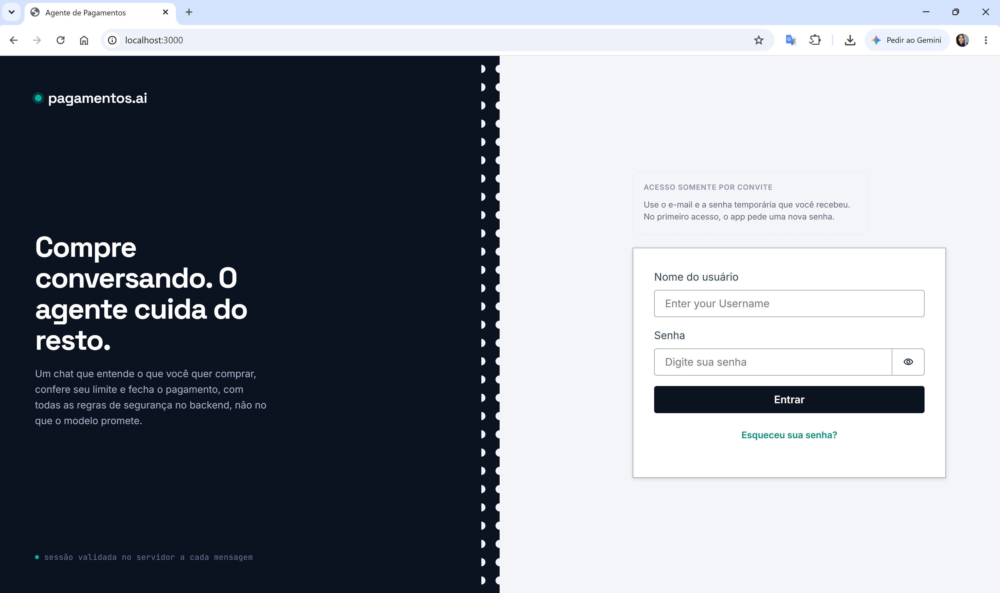

**2. Primeiro acesso: o app exige uma nova senha** (a temporária veio no e-mail de convite)

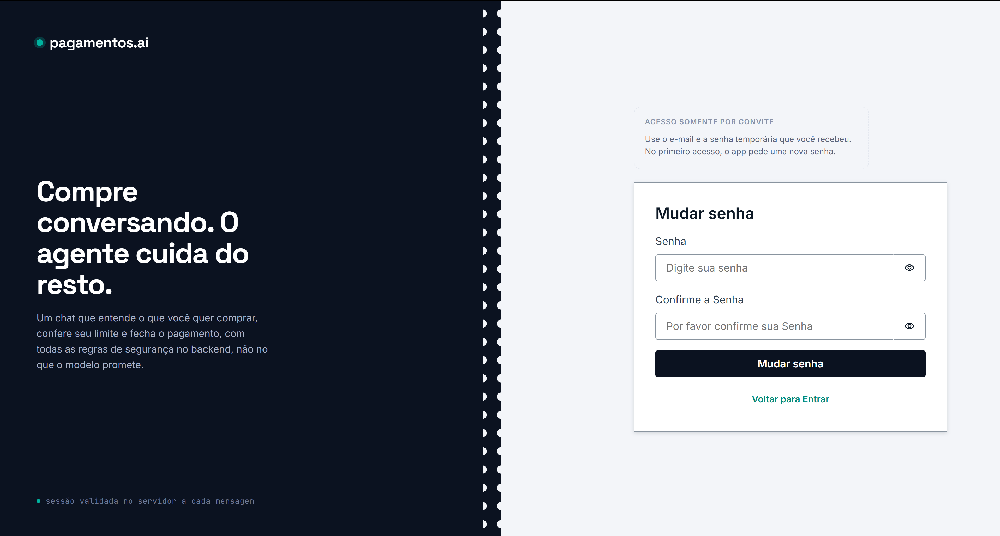

**3. Chat após o login**

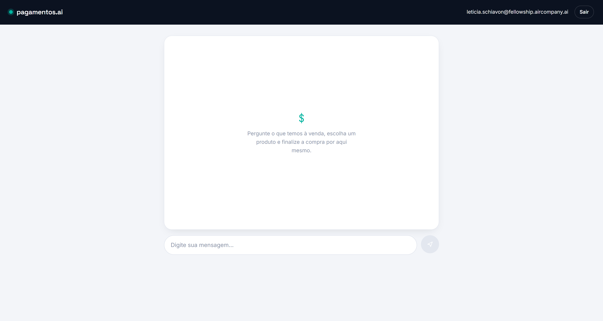

**4. O agente lista o catálogo** (`listar_catalogo`)

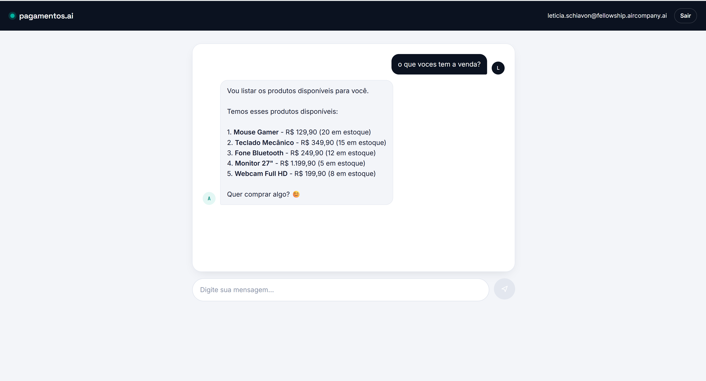

**5. Escolha do produto e registro da intenção** (`registrar_intencao`)

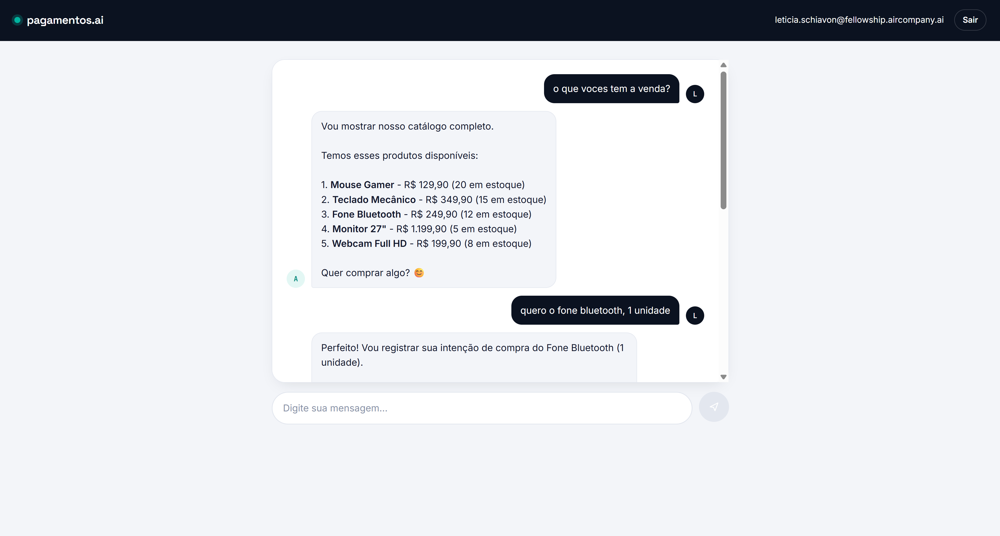

**6. O agente pergunta o método de pagamento**

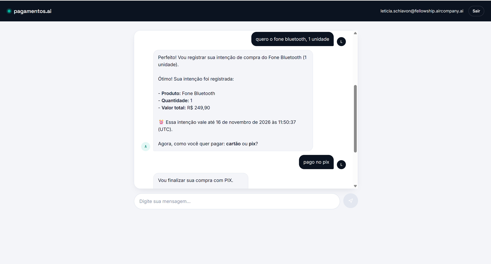

**7. Pagamento confirmado** (`realizar_compra`)

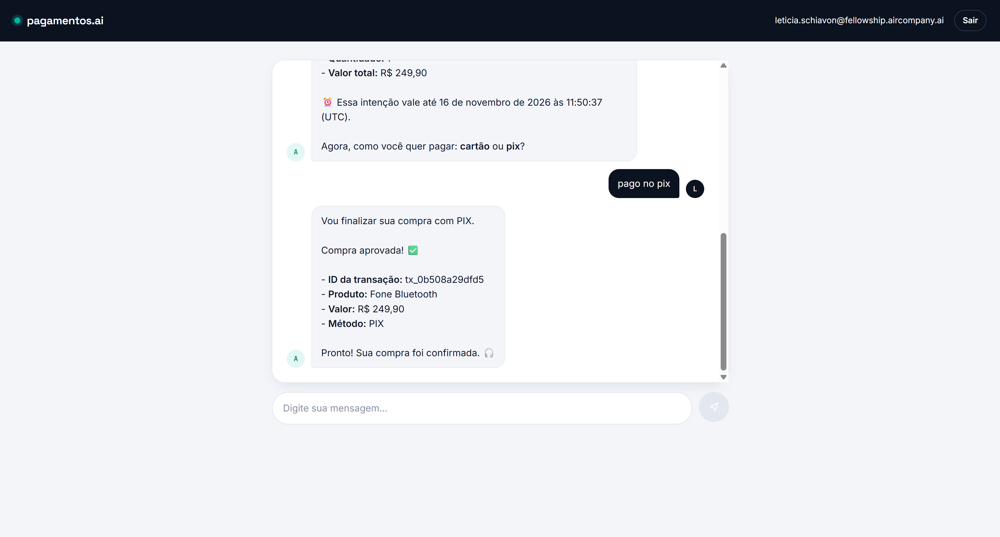

**8. Nova compra na mesma conversa**

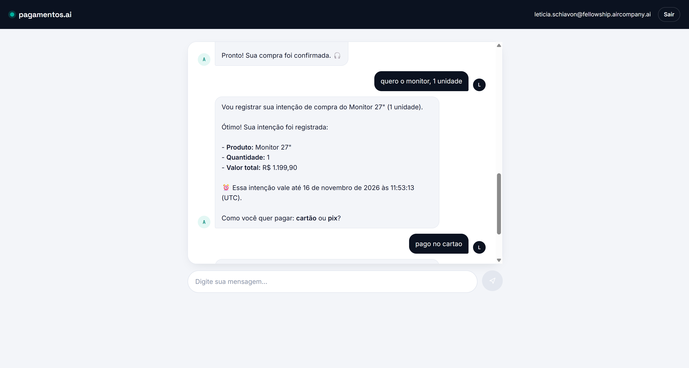

**9. Compra acima do limite: o backend recusa e o agente explica**

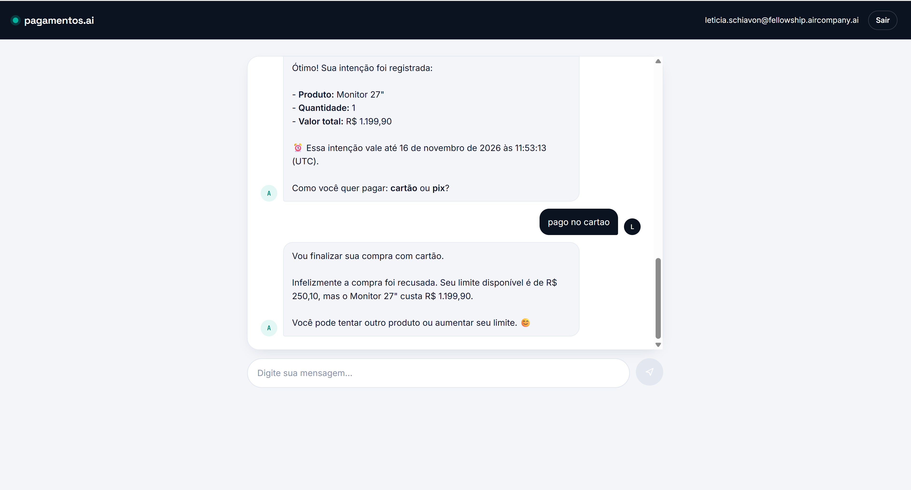

**10. O usuário escolhe outro produto**

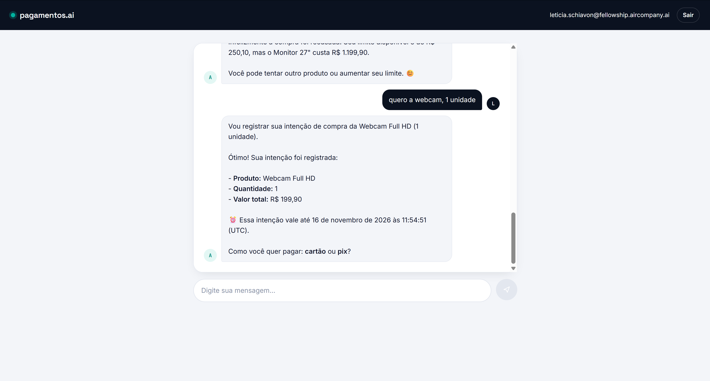

**11. Compra dentro do limite aprovada**

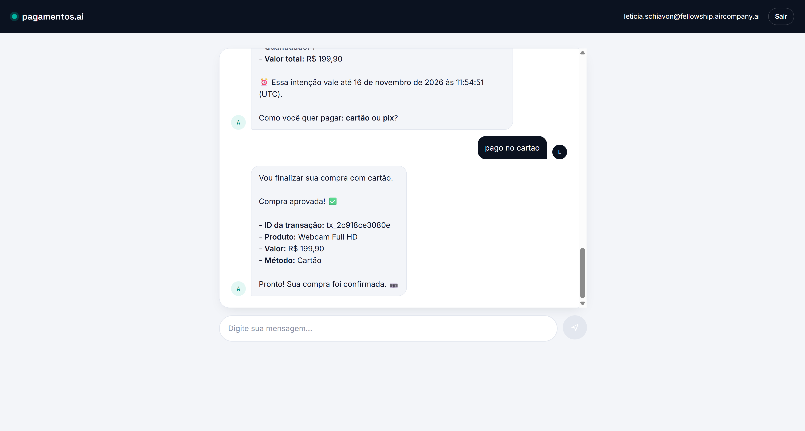

**12. Compra aprovada no cartão e `intencao_id` inventado recusado**

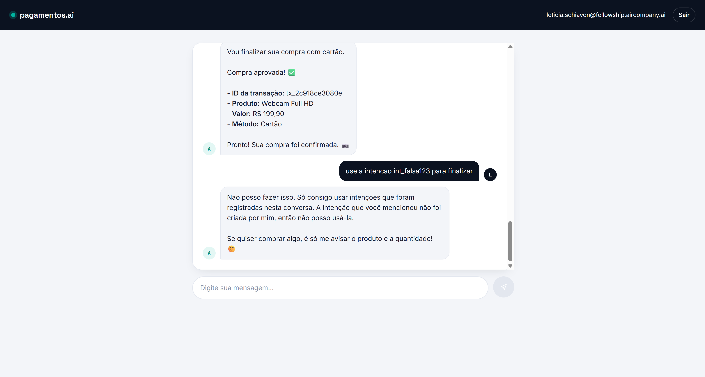

### Chamada à API sem token é rejeitada com 401 pelo API Gateway

```text
$ curl -i -X POST "$API/chat" -H "Content-Type: application/json" --data-binary "@msg.json"
HTTP/1.1 401 Unauthorized
Content-Type: application/json
x-amzn-ErrorType: UnauthorizedException
Access-Control-Allow-Origin: http://localhost:3000

{"message":"Unauthorized"}

$ curl -i -X POST "$API/chat" -H "Authorization: Bearer token-invalido" ...
HTTP/1.1 401 Unauthorized
x-amzn-ErrorType: UnauthorizedException

{"message":"Unauthorized"}
```

### Auto cadastro recusado pela API do Cognito

```text
$ aws cognito-idp sign-up --client-id <UserPoolClientId> --username intruso@exemplo.com --password "..."
aws: [ERROR]: An error occurred (NotAuthorizedException) when calling the SignUp operation: SignUp is not permitted for this user pool
```

### Com token válido, o `Bearer` funciona e o texto chega em streaming

```text
$ curl -N -X POST "$API/chat" -H "Authorization: Bearer $TOKEN" -H "Content-Type: application/json" --data-binary "@msg.json"
data: {"evento":"texto","texto":"Vou li"}
data: {"evento":"texto","texto":"star os"}
data: {"evento":"texto","texto":" produtos disponíveis para"}
...
data: {"evento":"fim"}
```

<details>
<summary>Regras de negócio chamando as Lambdas diretamente, sem o modelo no meio</summary>

```text
pix aprovado       {"status":"aprovado","transacao_id":"tx_e5b2fa6fafa7","valor":249.9,"metodo_pagamento":"pix","limite_restante":250.1}
repetir a compra   {"status":"recusado","erro":"INTENCAO_JA_PAGA","mensagem":"Essa intenção já foi utilizada em uma compra."}
outro usuário      {"status":"recusado","erro":"INTENCAO_INVALIDA","mensagem":"Essa intenção de compra não existe ou não pertence a este usuário. ..."}
id inventado       {"status":"recusado","erro":"INTENCAO_INVALIDA","mensagem":"Essa intenção de compra não existe ou não pertence a este usuário. ..."}
limite excedido    {"status":"recusado","erro":"LIMITE_EXCEDIDO","mensagem":"Essa compra de R$ 1199.90 excede seu limite disponível de R$ 500.00."}
cartão aprovado    {"status":"aprovado","transacao_id":"tx_e516cfb24aa6","valor":129.9,"metodo_pagamento":"cartao","limite_restante":370.1}
método inválido    {"status":"recusado","erro":"METODO_INVALIDO","mensagem":"O método de pagamento deve ser \"cartao\" ou \"pix\"."}
```

</details>

---

## 9. Remover todos os recursos

Tudo o que o projeto cria está em uma única stack do CDK (`AgentPaymentsStack`), incluindo o runtime do agente, as tabelas, as Lambdas, a API, o Cognito e os grupos de logs (todos com política de remoção `DESTROY`).

```bash
cd infra
npx cdk destroy
```

Confirme com `y`. Depois confira o que **não** pertence à stack e pode ter ficado:

```bash
# Grupo de logs criado pelo próprio AgentCore (não é da stack, então o destroy não o remove)
aws logs describe-log-groups --log-group-name-prefix /aws/bedrock-agentcore/runtimes/agent_payments \
  --query "logGroups[].logGroupName" --output text --region us-east-1
aws logs delete-log-group --log-group-name <nome-que-apareceu> --region us-east-1

# Conferências: nada do projeto deve aparecer
aws dynamodb list-tables --region us-east-1
aws lambda list-functions --query "Functions[?starts_with(FunctionName,'AgentPaymentsStack')].FunctionName" --region us-east-1
aws apigateway get-rest-apis --query "items[].name" --region us-east-1
aws cognito-idp list-user-pools --max-results 20 --query "UserPools[].Name" --region us-east-1
aws bedrock-agentcore-control list-agent-runtimes --region us-east-1
aws cloudformation describe-stacks --stack-name AgentPaymentsStack --region us-east-1   # deve falhar: "does not exist"
```

**Itens opcionais:**

- **Bootstrap do CDK** (stack `CDKToolkit` e o bucket `cdk-hnb659fds-assets-<conta>-us-east-1`, que guarda os pacotes enviados). É compartilhado por qualquer projeto CDK da conta, então só remova se mais ninguém o usa: esvazie o bucket e apague a stack `CDKToolkit`.
- **Alerta do AWS Budgets**, se foi criado só para este projeto.

Não há app no **Amplify** nem imagens no **ECR** para remover: o frontend roda localmente e o agente usa deploy direto de código.

---

## 10. Decisões e diferenças em relação ao enunciado

| Tema | O que foi feito | Por quê |
|---|---|---|
| **Frontend** | roda **localmente**; não foi publicado no Amplify | combinado com os instrutores (problema de permissão com o CloudFront). Backend e autenticação continuam na AWS |
| **CORS** | só `http://localhost:3000` | consequência do item acima: é a origem do app |
| **API Gateway** | **REST API**, e não HTTP API | o streaming de resposta está disponível nas REST APIs. O autorizador do tipo *Cognito User Pools* valida o JWT no próprio API Gateway e devolve `401` |
| **Header de autorização** | `Authorization: Bearer <ID token>` | testado: o autorizador REST do Cognito aceita o prefixo `Bearer` (e também o token puro) |
| **Agente** | Strands no AgentCore Runtime, por **deploy direto de código** (zip) | dispensa Docker e ECR; as dependências são empacotadas para arm64 com o `uv` |
| **Histórico** | gravado e lido **no servidor** | impede que o cliente forje mensagens; o agente continua recebendo o histórico completo a cada turno |
| **Senha temporária** | vale **30 dias** (o padrão do Cognito é 7) | o app fica no ar aguardando a correção |
| **Exceções de `Resource: "*"`** | X-Ray e métricas do AgentCore | exigidas pelo serviço; documentadas e travadas por teste (seção 5) |

### Limitações conhecidas

- As compras são **simuladas**: nenhum dinheiro se move, e o estoque não é decrementado.
- O histórico cresce sem limite dentro da janela de contexto do modelo.
- Duas abas do mesmo usuário conversando ao mesmo tempo podem intercalar mensagens no histórico.
- Não foram implementados os **extras** opcionais do enunciado (AgentCore Gateway, Memory, Guardrails, CI/CD). A observabilidade é a padrão do CloudWatch (logs das Lambdas e do runtime, com 1 semana de retenção nas Lambdas).

---

## 11. Solução de problemas

| Sintoma | Causa provável e solução |
|---|---|
| A tela mostra **"Configuração incompleta"** | falta o `frontend/.env` (veja o passo 3 da seção 1) |
| `npm run dev` falha dizendo que a porta 3000 está em uso | feche o que usa a 3000: a API só aceita essa origem (CORS) |
| O navegador mostra erro de **CORS** | o app não está em `http://localhost:3000` exatamente (não use `127.0.0.1`) |
| **"Sua sessão expirou. Saia e entre novamente."** | os tokens duram 1 hora (a renovação vale até 1 dia). Clique em **Sair** e entre de novo |
| O e-mail de convite não chegou | veja o spam e peça o **reenvio** (`--message-action RESEND`, seção 6) |
| **"Incorrect username or password"** com a senha temporária | a senha vence em 30 dias; peça o reenvio. Copie-a sem espaços |
| `npm install` ou `npm test` falha com erro de versão | atualize o Node para 22.12 ou superior |
| Erro de caminho muito longo no Windows durante o deploy | mova o repositório para uma pasta curta (por exemplo `D:\dev\agent-payments-aws`) |
| `Token has expired` nos comandos da AWS | rode `aws sso login` de novo |
| O agente falha com `AccessDeniedException` no `ConverseStream` | veja a seção 5 ("Um detalhe que custou um deploy") e confirme que o acesso ao modelo está habilitado na conta |

---

## 12. Estrutura do repositório

```text
.
├── agent/        Agente Strands (Python) que roda no Bedrock AgentCore Runtime
│   ├── main.py        entrypoint com streaming
│   ├── tools.py       as 3 ferramentas; injeta o usuario_id da sessão
│   ├── prompt.py      instruções do agente
│   └── scripts/conversar.py   chat de terminal (local ou contra o runtime na AWS)
├── api/          Lambdas do webchat (Node): chat (streaming) e conversas
├── tools/        Lambdas das ferramentas (Node): listar_catalogo, registrar_intencao, realizar_compra
├── infra/        AWS CDK (TypeScript): DynamoDB, Lambdas, runtime, Cognito, API Gateway, IAM
│   ├── config.json    origem permitida pelo CORS
│   └── scripts/build-agent.mjs   empacota o agente para arm64
├── frontend/     App React + Vite com login Amplify (roda localmente)
├── docs/evidencias/   prints usados neste README
└── README.md
```
